# system-tour

<p align="center">
  <a href="https://scalewave-tn.github.io/system-tour/"></a>
</p>

<p align="center">
  <a href="https://skills.sh/scalewave-tn/system-tour"></a>
</p>

<p align="center">
  <a href="https://scalewave-tn.github.io/system-tour/"><b>▶ Try the live demo</b></a>
  &nbsp;·&nbsp;
  <a href="#install">Install</a>
  &nbsp;·&nbsp;
  <a href="#use">Use</a>
</p>

A skill for Claude Code (and other agents that read `SKILL.md` skills) that turns a project's high-level design into an animated **system tour**: one HTML page with an isometric map of the solution and a player that walks through scenarios.

- **Normal use, scaling, failures, design choices.** Scenarios are grouped by angle: what happens when someone does a real task, what holds with more instances, what keeps working when a part is down, and why the system is split the way it is.
- **Moving packets.** Requests, responses, events, AI calls and refused calls travel along the wires, one move at a time, with a side panel that explains each step in plain words.
- **Home view.** The page opens on the whole map with several areas of the system running at once, and a list of areas to step into.
- **Several languages.** Write any text as `{"en": "…", "fr": "…"}` and readers get an EN / FR switcher.
- **Honest by design.** Parts that are not agreed or built are drawn dashed and marked "to confirm"; options that were not chosen are stamped "hypothetical".

The output is a single self-contained HTML file with no external dependencies, so it can be committed next to the architecture docs, attached to a review or published anywhere.

## Install

**With the skills CLI** (Node.js 22.20+), also listed on [skills.sh](https://skills.sh/scalewave-tn/system-tour/system-tour):

```bash
npx skills add scalewave-tn/system-tour
```

Add `-g` to install it for every project instead of the current one, and `-a claude-code` to pick the agent.

**As a Claude Code plugin:**

```
/plugin marketplace add scalewave-tn/system-tour
/plugin install system-tour@scalewave
```

**By hand:** copy `skills/system-tour/` to `~/.claude/skills/system-tour/` (all projects) or to `.claude/skills/system-tour/` in a project.

The build script needs **Python 3** and nothing else.

## Use

In a project, ask Claude for it, for example:

> Make a system tour of this project's architecture: how it behaves in normal use, under scaling, when something fails, and why each service exists.

Claude reads the architecture docs and code, proposes the scenarios, writes a tour JSON (for example `docs/architecture/system-tour.json`), builds the page and tests it in a browser.

You can also build a tour JSON yourself:

```bash
python3 skills/system-tour/scripts/build.py my-tour.json my-tour.html
python3 skills/system-tour/scripts/build.py my-tour.json --check   # validate only
```

The [live demo](https://scalewave-tn.github.io/system-tour/) is built from [`docs/demo-tour.json`](docs/demo-tour.json), a made-up shop in English and French. `skills/system-tour/assets/example-tour.json` is a smaller synthetic tour that uses every feature, and `skills/system-tour/references/data-format.md` documents every field.

## How it is built

| Path | What it is |
|---|---|
| `skills/system-tour/SKILL.md` | The workflow the agent follows, and the honesty and writing rules. |
| `skills/system-tour/assets/engine.html` | The page: layout, drawing, animation, controls, languages. Tours only supply data. |
| `skills/system-tour/scripts/build.py` | Validates a tour JSON and inlines it into the engine. |
| `skills/system-tour/references/` | The data format and how to choose scenarios. |
| `.claude-plugin/` | Plugin and marketplace manifests for Claude Code. |
| `docs/` | The live demo (`demo-tour.json`, built to `index.html`) and the README banner (`make-hero.py` draws `hero.svg`). |

## License

MIT, © Scalewave.
